<p align="center">
  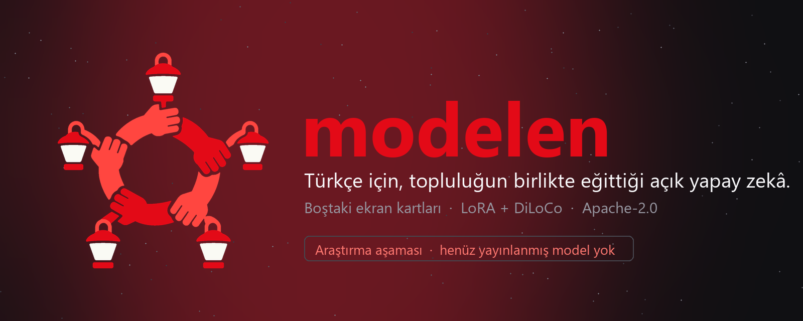
</p>

<p align="center">
  <a href="README.md">Türkçe</a> · <b>English</b>
</p>

<p align="center">
  <a href="https://modelen.tr"></a>
  
  
  
  
</p>

<p align="center">
  <b>We pool idle GPUs to train open language models together. Our first language is Turkish. The result is released under an open license for everyone to use.</b><br>
  <sub>An honest start: this is a research project. We have no released model yet; this repository shows <i>what we did, what we measured and what we could not measure</i> so far.</sub>
</p>

<p align="center">
  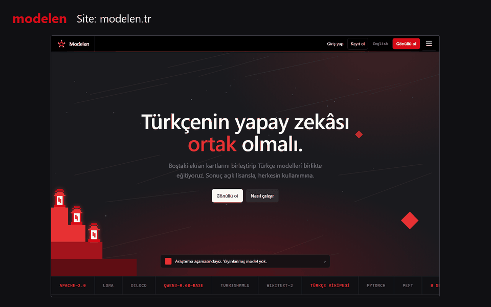
</p>

---

## Contents

[Idea](#idea) · [How it works](#how-it-works) · [What we measured](#what-we-measured-and-what-we-could-not) · [Components](#components) · [Security and privacy](#security-and-privacy-principles) · [Quick start](#quick-start) · [Repository map](#repository-map) · [Releases and history](#releases-and-history) · [Honest status](#honest-status-and-roadmap)

> The documentation, website and most in-repo notes are in Turkish. The docs site has English pages: [docs.modelen.tr](https://docs.modelen.tr).

## Idea

Every language needs open, locally runnable, transparently trained language models. We do not have a server room; but thousands of people have GPUs that sit idle for most of the day.

**Modelen** aims to pool these idle GPUs through voluntary contribution:

- 🔓 **Open:** code and model weights are Apache-2.0. Data sources and their licenses are listed openly.
- 🌍 **Language-focused, Turkish first:** we advance by measuring each language's structure; our pilot language is Turkish (tokenizer, bits per byte, TurkishMMLU). Other languages come next.
- 🤝 **Community-owned:** contributions are recorded; there are no money or crypto rewards, there is a voice and transparency.
- 🔒 **Privacy-respecting:** only a *fixed training script* runs on a volunteer's computer; it does not access files, and no arbitrary code is executed.
- 📉 **Communication-friendly:** instead of the whole model we carry only a small **LoRA adapter** (~40 MB).

> **No company.** This is a community initiative: the *Modelen Alternative Training Community*.

<p align="center">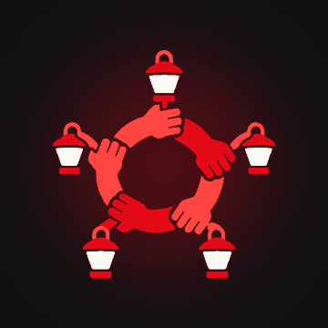<br><sub>Logo: the <b>Halay Ring</b>. Five arms, hand in hand; five lanterns. The shared light of idle GPUs.</sub></p>

## How it works

The method combines two known ideas: **LoRA** (freeze the base model and train only a small adapter) and **DiLoCo** (workers synchronise every *H* steps, not every step). The result: a single 8 GB consumer card can contribute, and the data moving over the network drops about 25×.

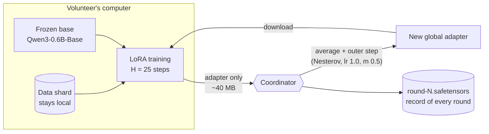

1. The coordinator hands out a **task** (which data shard, how many steps, which learning rate).
2. The volunteer downloads the global adapter (sha256 verified), **trains H steps locally**, and uploads the new adapter.
3. The coordinator validates the results (shape, type, NaN, outlier norm), averages them and applies the **outer step**.
4. The round ends, the new global adapter is saved; the loop continues.

Only **safetensors** is read from the network: no `pickle`, no code can be executed. Detailed protocol and an honest list of gaps: [`istemci/ISTEMCI.md`](istemci/ISTEMCI.md) (Turkish).

## What we measured (and what we could not)

Everything is small scale, on a **single RTX 4060 Laptop (8 GB)**. Raw outputs and scripts are in this repository. Full method and limits: [`ADAPTASYON.md`](ADAPTASYON.md) (Turkish) and the [Measurements page on the site](https://modelen.tr/olcumler.html).

<p align="center">
  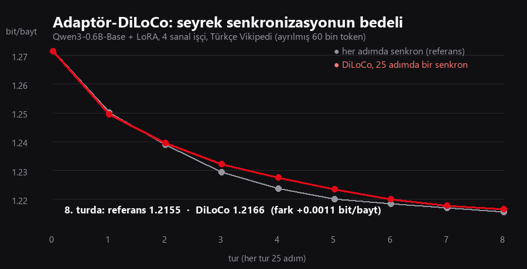
  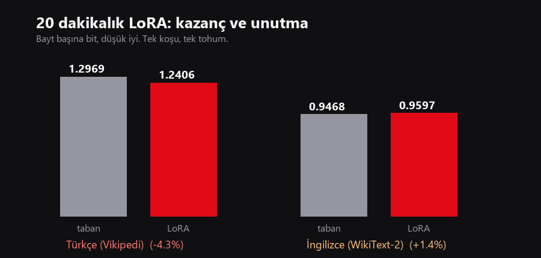
</p>

| # | Question | Result | Reliability |
|---|---|---|---|
| 1 | How much does sparse synchronisation (toy GPT) cost? | +0.07…+0.23 nat (depending on data and *H*) | 3 seeds, small model |
| 2 | Does a 20-minute LoRA improve Turkish? | Turkish bits/byte **1.297 → 1.241 (−4.3%)**; English +1.4% (mild forgetting); **TurkishMMLU unchanged** (35.6% → 34.7%, within noise) | single run, single seed |
| 3 | What is the cost of sparse synchronisation on the adapter? | After 8 rounds the difference is **0.0011 bits/byte (−0.09%)**; **~25× less** data (≈32 GB → ≈1.3 GB) | single seed, 200 steps, 60k-token evaluation |
| 4 | Does the protocol work end to end? | 2 workers × 3 rounds, no result rejected; 1.2714 → 1.2613 bits/byte | single machine, single seed |

> ⚠️ **What we do not claim:** we are not saying "the Turkish model improved". Language-modelling loss went down, but the knowledge/reasoning benchmark did not move; that needs billions of tokens and diverse data. The evidence we have is: *the method works, the memory and speed budget has been measured, and the cost of sparse synchronisation is negligible at this scale.* We will not claim more until we can prove it.

## Components

<table>
<tr>
<td width="50%" valign="top">

### 🖥️ Desktop app (Rust)
A single exe (~10 MB, egui). **Easy mode:** one page, a big ON/OFF button; you dedicate your GPU to a coordinator. **Advanced:** coordinator, nickname, local model server, logs; an **Ask the community** panel. It hides in the system tray, and API keys live only in the Windows credential vault.

`uygulama/` · [`UYGULAMA.md`](uygulama/UYGULAMA.md) · 15 unit tests

</td>
<td width="50%" valign="top">
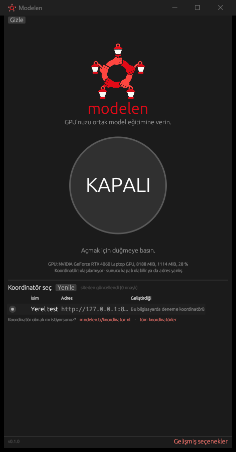
</td>
</tr>
<tr>
<td width="50%" valign="top">
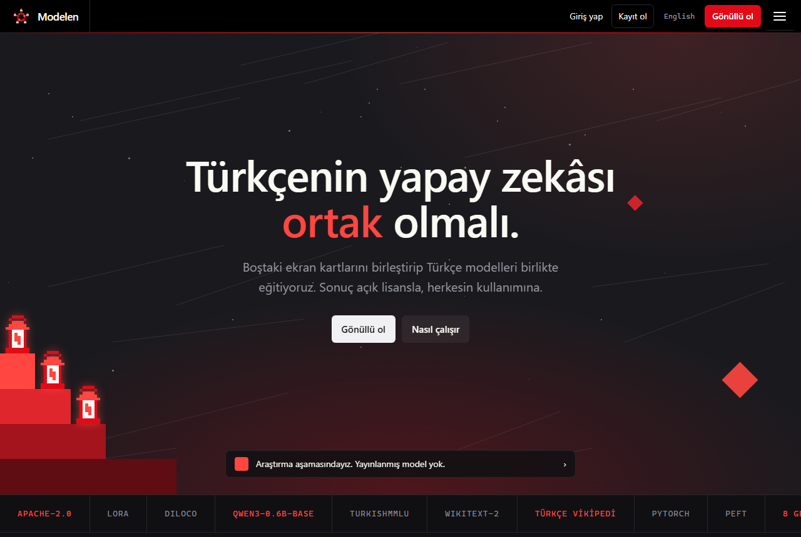
</td>
<td width="50%" valign="top">

### 🌐 Website and portal (modelen.tr)
34 pages, TR + EN, cookie-free, no third-party resources. **Portal** (single-file Python, SQLite): sign-up/login, **e-mail verification and password reset (SMTP)**, **coordinator applications** (address optional, Hugging Face link, images, approved profile editing), public **Coordinators** pages, an **admin panel**, **profiles**, social links, following, a short-post **feed**, blocking/notifications and moderation. Profiles are **private** by default.

The web side (site, portal, docs source) is kept in a separate private repository; this repository is the product itself.

</td>
</tr>
<tr>
<td width="50%" valign="top">

### 🔁 Volunteer client and coordinator (Python)
The adapter-DiLoCo protocol: coordinator (`/gorev`, `/agirlik`, `/sonuc`), worker, evaluation. Safetensors, sha256, outlier-delta elimination, one result per round. A local **OpenAI-compatible model server** (`sunucu/`).

`istemci/` · `sunucu/` · [`ISTEMCI.md`](istemci/ISTEMCI.md)

</td>
<td width="50%" valign="top">
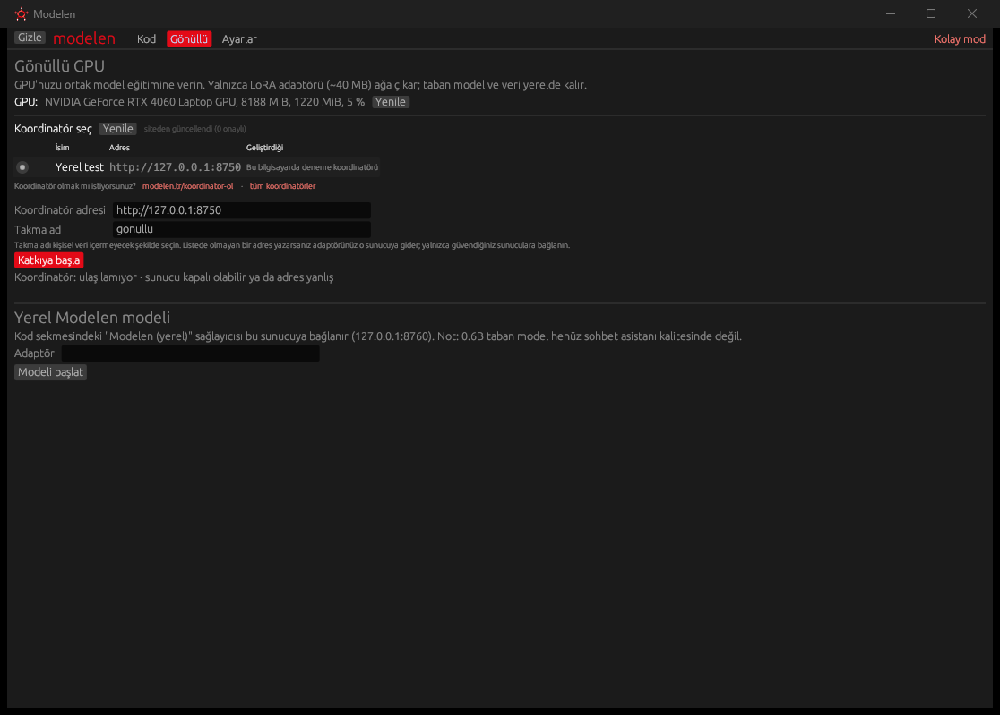
</td>
</tr>
<tr>
<td width="50%" valign="top">
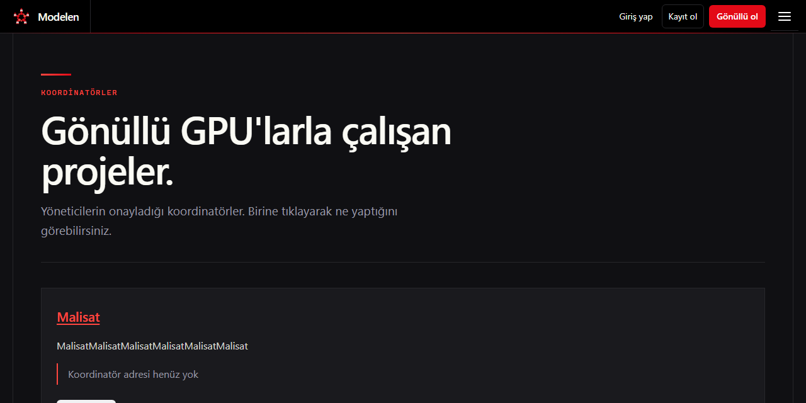
</td>
<td width="50%" valign="top">

### 🧪 Research scripts
DiLoCo simulation, LoRA continued pre-training, Turkish/English/TurkishMMLU evaluations, seed × sync-interval sweeps, an outer-optimizer grid, adapter-DiLoCo. Raw results are in the repository as JSON/logs.

`diloco_sim.py` · `lora_cpt.py` · `olc_*.py` · `adaptor_diloco.py` · `sweep*/` · `grid-wiki/`

</td>
</tr>
</table>

<p align="center">
  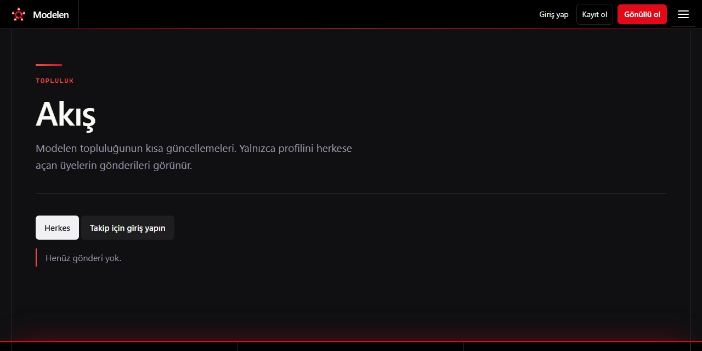
  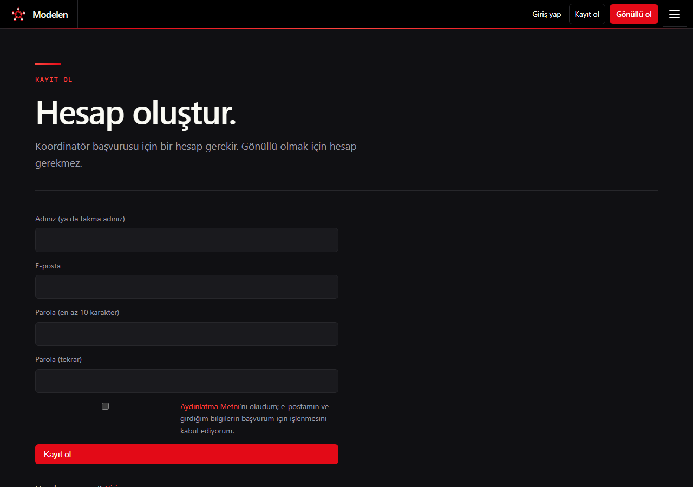
  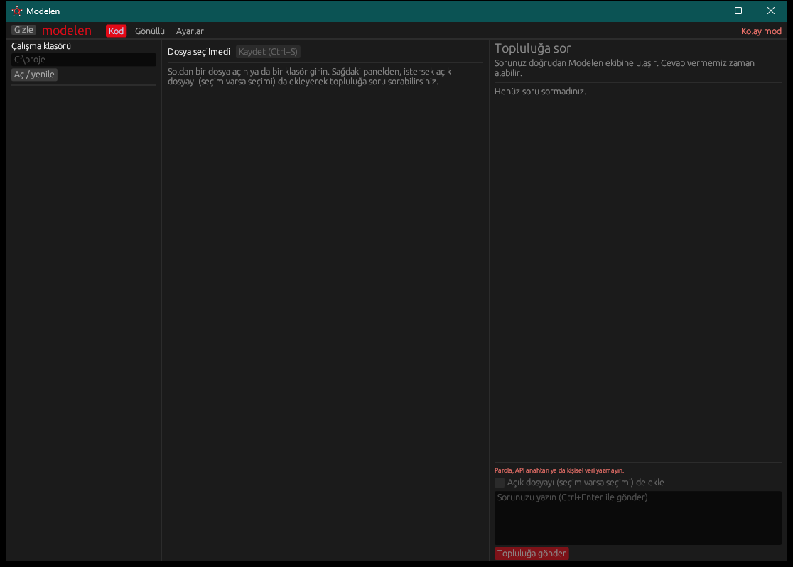
</p>

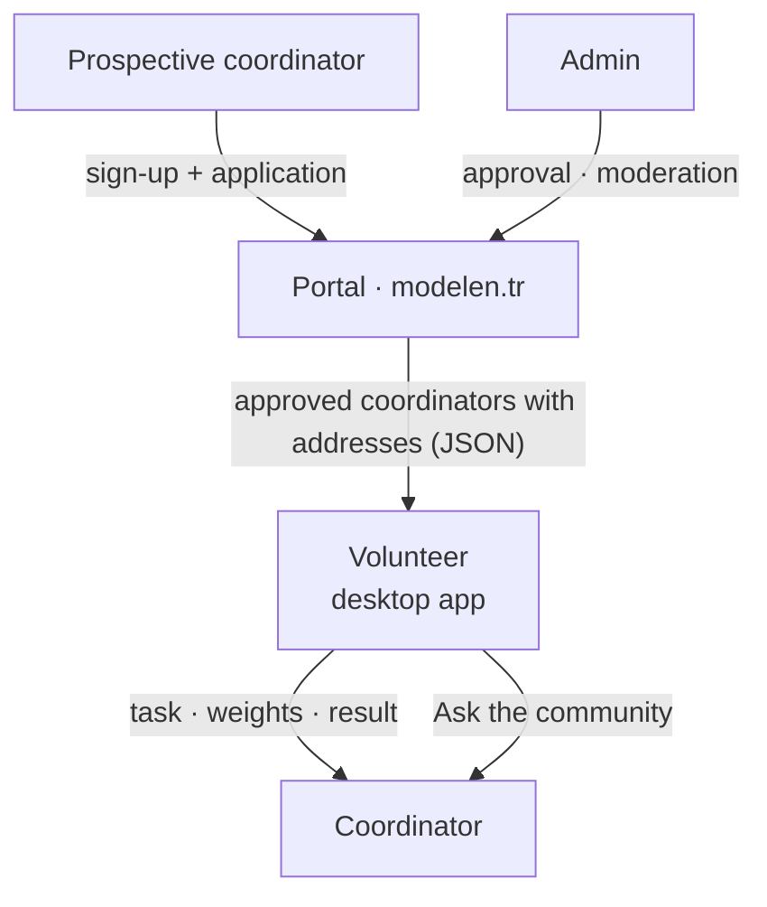

**For developers:** to become a coordinator, plug in your own training system and use the Portal API, see **[docs.modelen.tr](https://docs.modelen.tr)**. For this purpose we added a protocol v1 conformance test (`istemci/uyum_testi.py`), a sample coordinator and a Python API client written with the standard library only (`istemci/ornekler/`), and an OpenAPI schema (`/api/v1/openapi.json`).

**Also:** `ide/` (an old VS Code extension prototype, **no longer used**).

## Security and privacy principles

- Only the **published training script** runs on a volunteer's computer; a coordinator cannot send arbitrary code.
- Weights are **safetensors only**; results are checked for shape/type/NaN/outlier norm.
- Portal: scrypt password hashes, `HttpOnly + SameSite + Secure` cookies, CSRF token, login/sign-up rate limiting, all user text HTML-escaped, parameterised SQL, CSP headers, **EXIF/location stripping** from images, e-mail visible to admins only.
- **Profiles are private by default.** Until someone makes it "public", their name, photo and posts are not visible.
- API keys (in the app) live only in the operating system's credential vault; they are not written to the settings file.

> The legal texts (KVKK, privacy, cookies, community rules, terms) are published on the site; **they have not been reviewed by a lawyer**.

## Quick start

**Desktop app** (Windows; Rust stable):

```bash
cd uygulama
cargo build --release
./target/release/modelen.exe          # --tepside starts it in the tray
cargo test --release                  # 15 tests
```

**Try the volunteer protocol locally** (CUDA GPU, PyTorch, `transformers`, `peft`, `safetensors`; Qwen3-0.6B-Base under `models/qwen3-0.6b-base`): step-by-step commands are in [`istemci/ISTEMCI.md`](istemci/ISTEMCI.md). Data and model files are not in the repository (large and licensed); `wiki_to_txt.py` produces the Wikipedia text.

## Repository map

```
modelen/            (web side — site, portal, docs — in a separate private repository)
├─ README.md · ADAPTASYON.md · LICENSE · NOTICE
├─ diloco_sim.py · lora_cpt.py · olc_*.py · adaptor_diloco.py · wiki_to_txt.py   research scripts
├─ sweep/ · sweep-wiki/ · grid-wiki/ · *.json · olcum-sonuc.txt                  raw results
├─ istemci/    volunteer client: coordinator, worker, evaluation, ISTEMCI.md
├─ sunucu/     local OpenAI-compatible model server
├─ uygulama/   Rust desktop app (egui)
├─ kurulum/    Modelen-Kurulum.exe (Rust installer that embeds kur.ps1)
├─ kur.ps1 · kur.sh   Windows and Linux (Ubuntu, Arch) install scripts
├─ tools/      release packaging (paketle.py)
├─ .github/    release pipeline and install tests (CI)
├─ ide/        old VS Code prototype (unused)
└─ docs/       working notes, image generation script, README images
```

## Releases and history

> **Note:** The working folder was originally not under git. This repository is a history **reconstructed from file timestamps**: each commit carries (approximately) the date and time work on that component began, and contains the component's *current* state. Intermediate versions (e.g. the site's 9 design rounds) were not stored separately. Release tags are milestones.

| Version | Date | What's in it |
|---|---|---|
| [`v0.1.0`](../../releases/tag/v0.1.0) | 2026-11-06 | **Research:** DiLoCo simulation, seed×interval sweeps, replication with Turkish Wikipedia, 20-min LoRA adaptation, forgetting and TurkishMMLU measurement, adapter-DiLoCo |
| [`v0.2.0`](../../releases/tag/v0.2.0) | 2026-11-07 | **Identity and client:** logo (Halay Ring), TR+EN site, volunteer client prototype, local model server, Rust desktop app, corporate documents, Apache-2.0 |
| [`v0.3.0`](../../releases/tag/v0.3.0) | 2026-11-08 | **Portal and community:** coordinator directory and application, admin panel, profiles, social links, following, feed, moderation; modelen.tr went live |
| [`v0.3.1`](../../releases/tag/v0.3.1) | 2026-11-08 | **Documentation:** README, images, deployment examples |
| [`v0.4.0`](../../releases/tag/v0.4.0) | 2026-11-08 | **E-mail:** e-mail verification via SMTP, password reset and application-status notifications; international positioning |

## Honest status and roadmap

**Working:** the protocol end to end (on one machine and over the internet, VDS↔PC), the Rust app (builds, tests pass), the portal and API live, the site and [docs](https://docs.modelen.tr) published, **volunteer installation available (alpha)**: `Modelen-Kurulum.exe` for Windows, `kur.sh` for Ubuntu ([Releases](../../releases/latest)).

**Not yet / missing:**

- [ ] A released model. The 0.6B base is not a chat assistant; instruction tuning (SFT) is a separate step.
- [ ] Training moving out of Python (currently a subprocess; the Windows installer and the Ubuntu script set up the Python environment themselves, but there is no signed release).
- [ ] Authentication on the coordinator side, real poisoning protection (repeated verification), TLS.
- [ ] Experiments with multiple seeds and non-IID data; the DiLoCo → DDP compatibility question.
- [ ] An end-to-end trial with real volunteers (different hardware). (The install scripts are tested on GitHub's clean Windows/Ubuntu machines without a GPU; real GPU training is not yet.)
- [ ] An English portal interface, two-step verification. (E-mail verification, password reset and application notifications via SMTP are **done**.)
- [ ] Lawyer review (the "draft" warning was removed from the legal texts; no legal review has been done).
- [ ] Manual testing of every button in the app (the logic underneath is tested; interactions were tried visually but there is no thorough manual test).

## Join

- 🌐 **Site:** [modelen.tr](https://modelen.tr) · to become a coordinator, [sign up](https://modelen.tr/kayit)
- 📬 **Contact:** iletisim@modelen.tr
- 🐞 For bugs or suggestions you can open an *issue* in this repository.

**License:** [Apache-2.0](LICENSE) (code and model). For third-party components and data licenses see [`NOTICE`](NOTICE) and [`ADAPTASYON.md`](ADAPTASYON.md). Base model: Qwen3-0.6B-Base (Apache-2.0). Turkish Wikipedia text is CC BY-SA/GFDL; it is not distributed in this repository.
