<p align="center">
  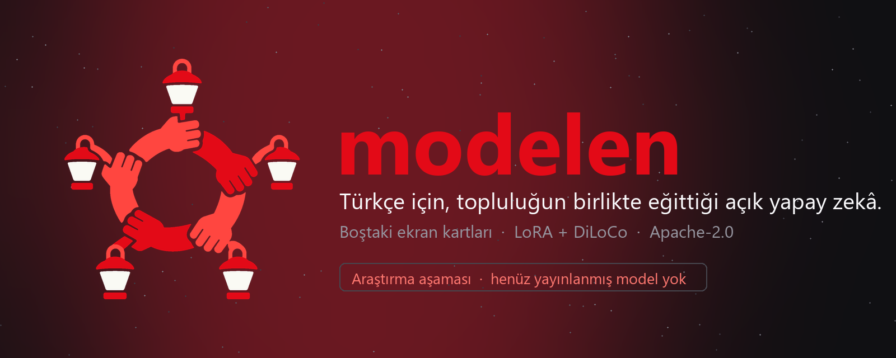
</p>

<p align="center">
  <a href="https://modelen.tr"></a>
  
  
  
  
</p>

<p align="center">
  <b>Boştaki ekran kartlarını birleştirip Türkçe modelleri birlikte eğitiyoruz. Sonuç açık lisansla, herkesin kullanımına.</b><br>
  <sub>Dürüst başlangıç: bu bir araştırma projesi. Yayınlanmış bir modelimiz henüz yok; bu depo, şimdiye kadar <i>ne yaptığımızı, ne ölçtüğümüzü ve ne ölçemediğimizi</i> gösteriyor.</sub>
</p>

<p align="center">
  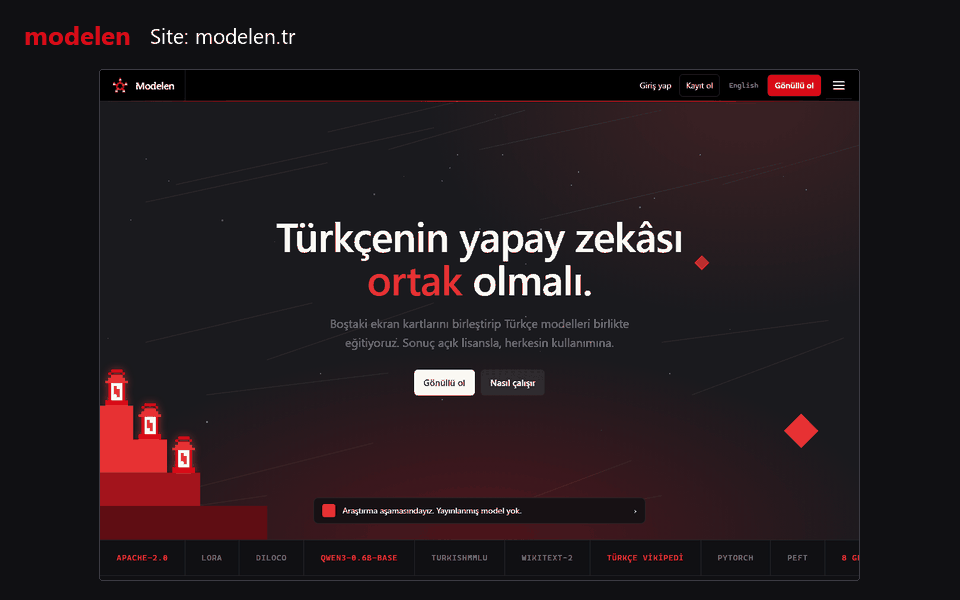
</p>

---

## İçindekiler

[Fikir](#fikir) · [Nasıl çalışır](#nasıl-çalışır) · [Ne ölçtük](#ne-ölçtük-ve-ne-ölçemedik) · [Bileşenler](#bileşenler) · [Güvenlik ve gizlilik](#güvenlik-ve-gizlilik-ilkeleri) · [Hızlı başlangıç](#hızlı-başlangıç) · [Depo haritası](#depo-haritası) · [Sürümler ve tarihçe](#sürümler-ve-tarihçe) · [Dürüst durum](#dürüst-durum-ve-yol-haritası) · [English](#english-summary)

## Fikir

Türkçe için açık, yerelde çalışabilen ve şeffaf biçimde eğitilmiş dil modellerine ihtiyaç var. Büyük bir sunucu salonumuz yok; ama binlerce insanın bilgisayarında günün çoğunda boş duran ekran kartları var.

**Modelen**, bu boş GPU'ları gönüllü katkıyla birleştirmeyi hedefliyor:

- 🔓 **Açık:** kod ve model ağırlıkları Apache-2.0. Veri kaynakları ve lisansları açıkça listelenir.
- 🇹🇷 **Türkçe öncelikli:** Türkçenin eklemeli yapısını ölçerek geliştiriyoruz (tokenizer, bayt başına bit, TurkishMMLU).
- 🤝 **Topluluk sahipli:** katkılar kayıt altında; para ya da kripto ödülü yok, söz hakkı ve şeffaflık var.
- 🔒 **Gizliliğe saygılı:** gönüllünün bilgisayarında yalnızca *sabit bir eğitim betiği* çalışır; dosyalara erişmez, keyfi kod çalıştırılmaz.
- 📉 **Haberleşme dostu:** tüm modeli değil yalnızca küçük bir **LoRA adaptörünü** (~40 MB) taşıyoruz.

> **Şirket yok.** Bu bir topluluk girişimi: *Modelen Alternatif Eğitim Topluluğu*.

<p align="center"><br><sub>Logo: <b>Halay Halkası</b>. Beş kol, el ele tutuşmuş; beş fener. Boştaki GPU'ların ortak ışığı.</sub></p>

## Nasıl çalışır

Yöntem iki bilinen fikri birleştirir: **LoRA** (taban modeli dondurup yalnızca küçük bir adaptör eğitmek) ve **DiLoCo** (işçilerin her adımda değil, her *H* adımda bir senkronize olması). Sonuç: 8 GB'lık tek bir tüketici kartı katkı verebilir ve ağda dolaşan veri ~25 kat azalır.

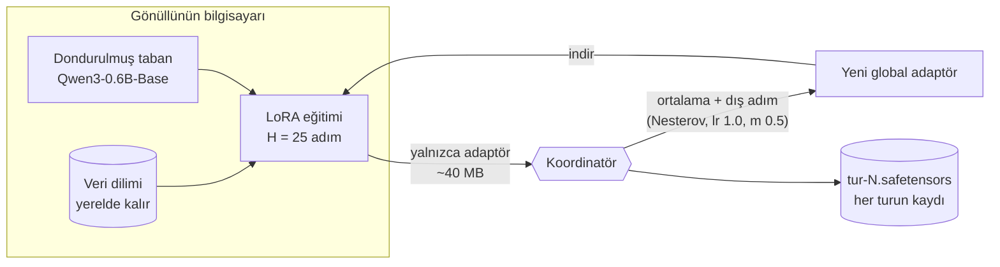

1. Koordinatör bir **görev** verir (hangi veri dilimi, kaç adım, hangi öğrenme oranı).
2. Gönüllü, global adaptörü indirir (sha256 doğrulanır), **H adım yerelde eğitir**, yeni adaptörü yükler.
3. Koordinatör sonuçları doğrular (şekil, tür, NaN, aykırı norm), ortalar ve **dış adımı** uygular.
4. Tur biter, yeni global adaptör kaydedilir; döngü sürer.

Ağdan yalnızca **safetensors** okunur: `pickle` yok, kod çalıştırılamaz. Ayrıntılı protokol ve dürüst eksik listesi: [`istemci/ISTEMCI.md`](istemci/ISTEMCI.md).

## Ne ölçtük (ve ne ölçemedik)

Her şey küçük ölçekte, **tek RTX 4060 Laptop (8 GB)** üstünde. Ham çıktılar ve betikler bu depoda. Tam yöntem ve sınırlar: [`ADAPTASYON.md`](ADAPTASYON.md) ve [sitedeki Ölçümler sayfası](https://modelen.tr/olcumler.html).

<p align="center">
  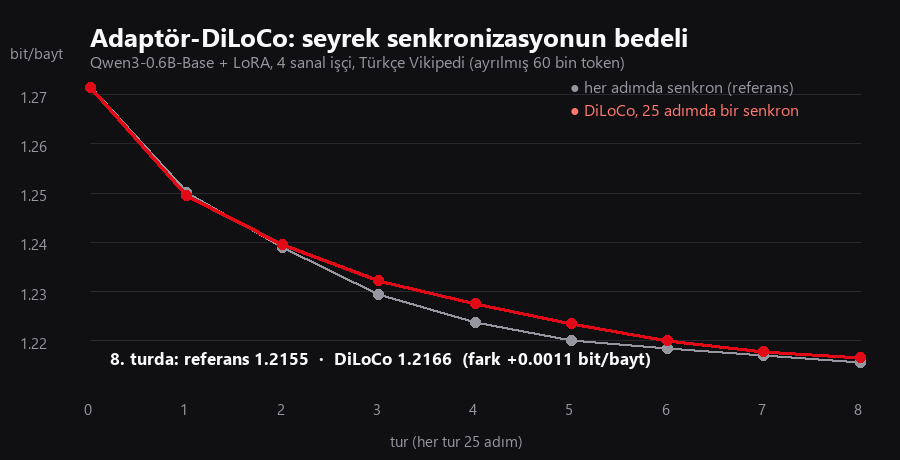
  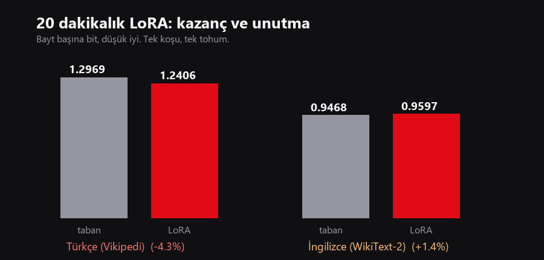
</p>

| # | Soru | Sonuç | Güvenilirlik |
|---|---|---|---|
| 1 | Seyrek senkronizasyon (oyuncak GPT) ne kadar kaybettirir? | +0,07…+0,23 nat (veriye ve *H*'ye göre) | 3 tohum, küçük model |
| 2 | 20 dakikalık LoRA Türkçeyi iyileştirir mi? | Türkçe bit/bayt **1,297 → 1,241 (−%4,3)**; İngilizce +%1,4 (hafif unutma); **TurkishMMLU değişmedi** (%35,6 → %34,7, gürültü içinde) | tek koşu, tek tohum |
| 3 | Adaptörde seyrek senkronizasyonun bedeli? | 8 turda fark **0,0011 bit/bayt (−%0,09)**; **~25× az** veri (≈32 GB → ≈1,3 GB) | tek tohum, 200 adım, 60 bin token ölçüm |
| 4 | Protokol uçtan uca çalışıyor mu? | 2 işçi × 3 tur, hiçbir sonuç reddedilmedi; 1,2714 → 1,2613 bit/bayt | tek makine, tek tohum |

> ⚠️ **Ne iddia etmiyoruz:** "Türkçe model iyileşti" demiyoruz. Dil modelleme kaybı düştü, ama bilgi/muhakeme kıyası kıpırdamadı; bunun için milyarlarca token ve çeşitli veri gerekir. Elimizdeki kanıt şu: *yöntem çalışıyor, bellek ve hız bütçesi ölçüldü, seyrek senkronizasyonun bedeli bu ölçekte ihmal edilebilir.* Daha fazlasını kanıtlamadan söylemeyeceğiz.

## Bileşenler

<table>
<tr>
<td width="50%" valign="top">

### 🖥️ Masaüstü uygulaması (Rust)
Tek exe (~10 MB, egui). **Kolay mod:** tek sayfa, büyük AÇIK/KAPALI düğmesi; GPU'nuzu bir koordinatöre adarsınız. **Gelişmiş:** koordinatör, takma ad, yerel model sunucusu, günlükler; **Topluluğa sor** paneli. Sistem tepsisine gizlenir, API anahtarları yalnızca Windows kimlik kasasında.

`uygulama/` · [`UYGULAMA.md`](uygulama/UYGULAMA.md) · 15 birim testi

</td>
<td width="50%" valign="top">
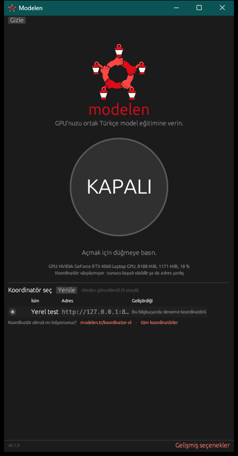
</td>
</tr>
<tr>
<td width="50%" valign="top">
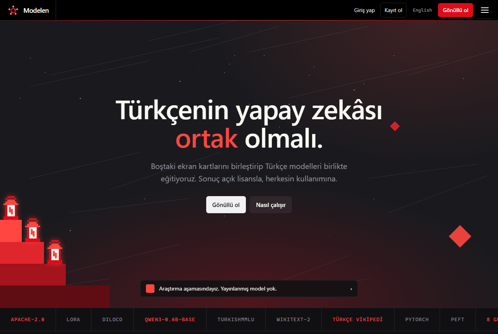
</td>
<td width="50%" valign="top">

### 🌐 Site ve portal (modelen.tr)
34 sayfa, TR + EN, çerezsiz, üçüncü taraf kaynaksız. **Portal** (tek dosya Python, SQLite): kayıt/giriş, **koordinatör başvurusu** (adres isteğe bağlı, Hugging Face bağlantısı, görseller, onaylı profil düzenleme), herkese açık **Koordinatörler** sayfaları, **yönetici paneli**, **profiller**, sosyal bağlantılar, takip, kısa gönderi **akışı**, engel/bildirim ve moderasyon. Profil varsayılan **gizli**.

`site/` · `portal/` · [`PORTAL.md`](portal/PORTAL.md) · 34 test

</td>
</tr>
<tr>
<td width="50%" valign="top">

### 🔁 Gönüllü istemci ve koordinatör (Python)
Adaptör-DiLoCo protokolü: koordinatör (`/gorev`, `/agirlik`, `/sonuc`), işçi, değerlendirme. Safetensors, sha256, aykırı delta elemesi, tur başına tek sonuç. Yerel **OpenAI uyumlu model sunucusu** (`sunucu/`).

`istemci/` · `sunucu/` · [`ISTEMCI.md`](istemci/ISTEMCI.md)

</td>
<td width="50%" valign="top">
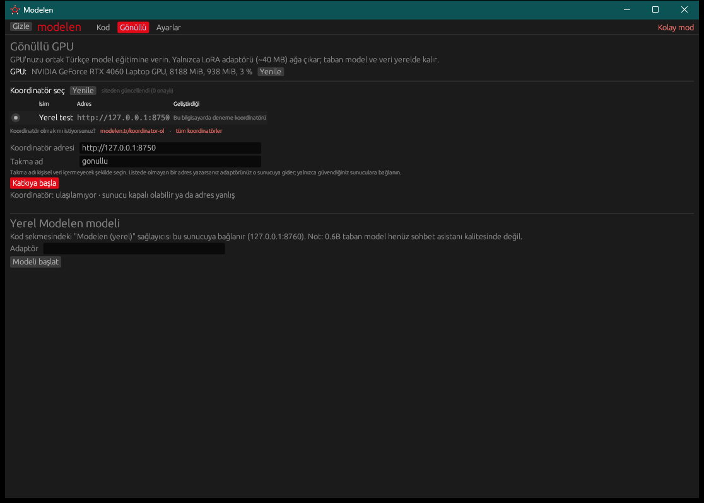
</td>
</tr>
<tr>
<td width="50%" valign="top">
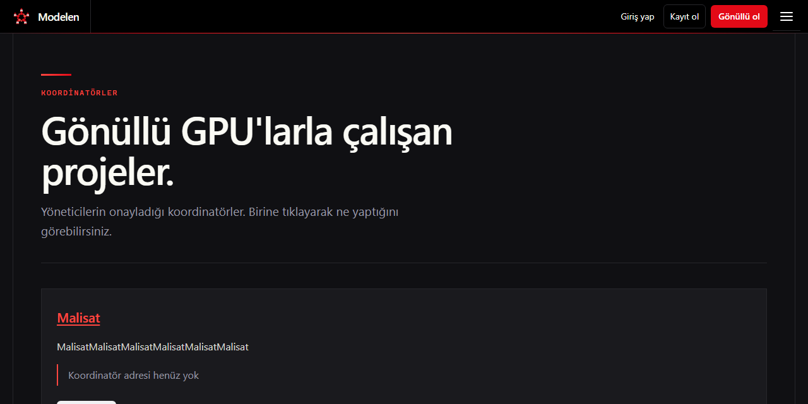
</td>
<td width="50%" valign="top">

### 🧪 Araştırma betikleri
DiLoCo benzetimi, LoRA sürekli ön eğitim, Türkçe/İngilizce/TurkishMMLU ölçümleri, tohum × senkron aralığı taraması, dış optimizer ızgarası, adaptör-DiLoCo. Ham sonuçlar JSON/günlük olarak depoda.

`diloco_sim.py` · `lora_cpt.py` · `olc_*.py` · `adaptor_diloco.py` · `sweep*/` · `grid-wiki/`

</td>
</tr>
</table>

<p align="center">
  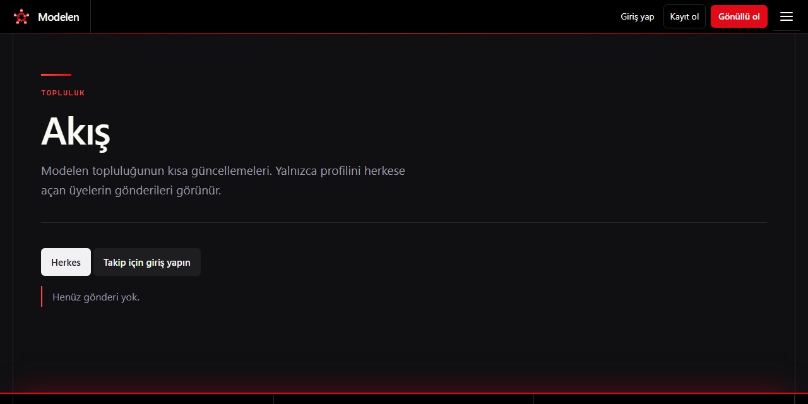
  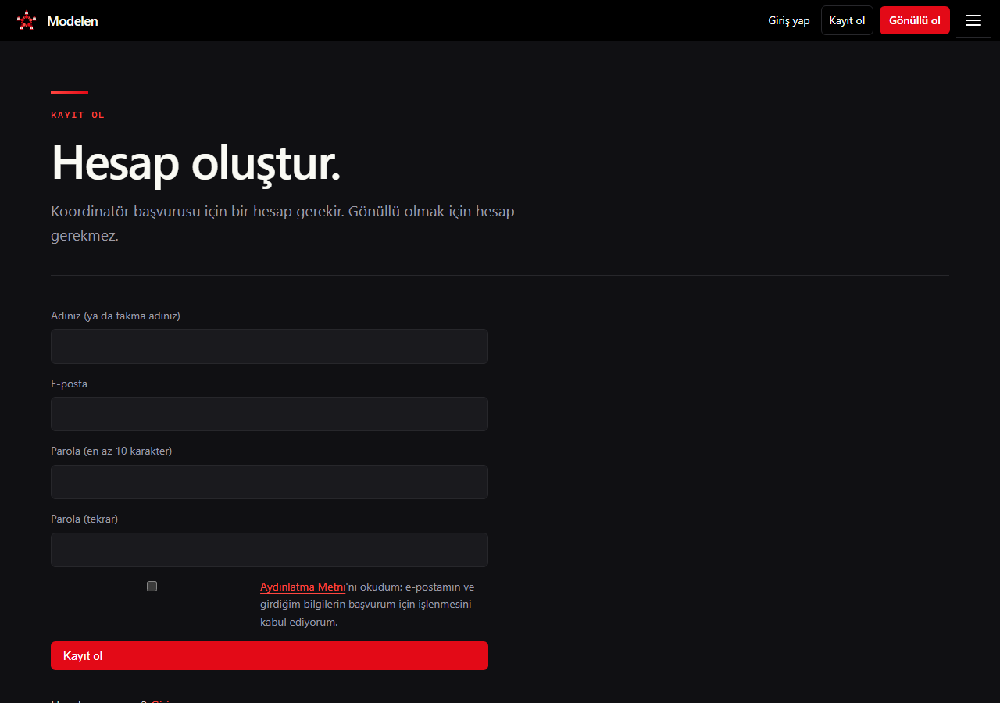
  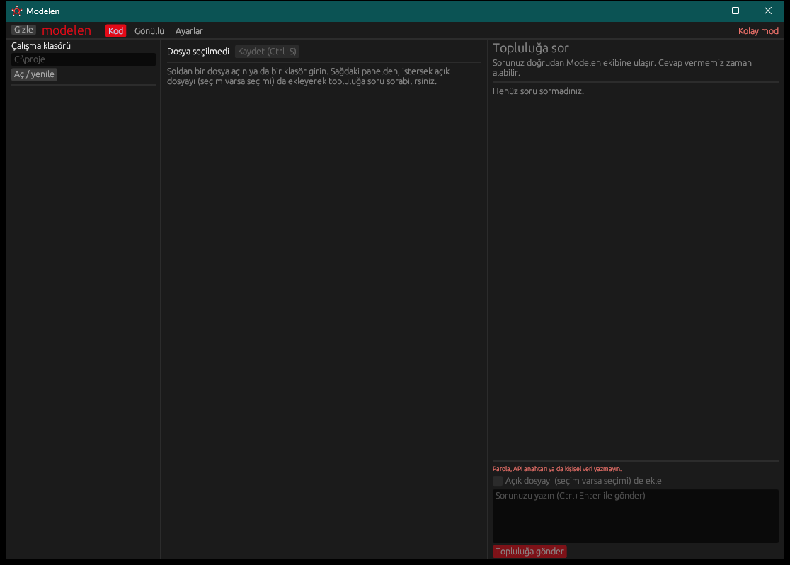
</p>

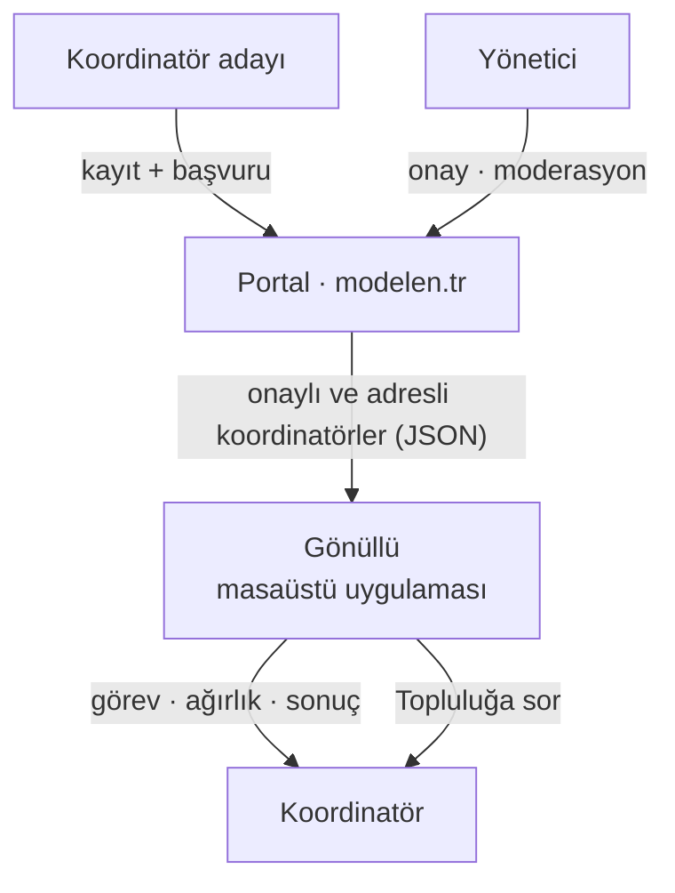

**Ayrıca:** `logo/` (100 SVG kavram, seçilen *Halay Halkası* vektör sürümleri ve üretim betikleri), `kurumsal/` (kimlik notları ve avukat onay listesi), `ide/` (eski VS Code eklentisi prototipi, **artık kullanılmıyor**).

## Güvenlik ve gizlilik ilkeleri

- Gönüllü bilgisayarında **yalnızca yayımlanmış eğitim betiği** çalışır; koordinatör keyfi kod gönderemez.
- Ağırlıklar yalnızca **safetensors**; sonuçlarda şekil/tür/NaN/aykırı norm kontrolü.
- Portal: scrypt parola özeti, çerezler `HttpOnly + SameSite + Secure`, CSRF belirteci, giriş/kayıt hız sınırı, tüm kullanıcı metni HTML kaçışlı, parametreli SQL, CSP başlıkları, görsellerden **EXIF/konum silme**, e-posta yalnızca yöneticide.
- **Profil varsayılan gizlidir.** Kişi "herkese açık" yapmadıkça adı, fotoğrafı ve gönderileri görünmez.
- API anahtarları (uygulamada) yalnızca işletim sistemi kimlik kasasında; ayar dosyasına yazılmaz.

> Yasal metinler (KVKK, gizlilik, çerez, topluluk kuralları, koşullar) **taslaktır**; yayından önce avukat onayı gerekir ([`kurumsal/AVUKAT-ONAY-LISTESI.md`](kurumsal/AVUKAT-ONAY-LISTESI.md)).

## Hızlı başlangıç

**Masaüstü uygulaması** (Windows; Rust stable):

```bash
cd uygulama
cargo build --release
./target/release/modelen.exe          # --tepside ile tepside başlar
cargo test --release                  # 15 test
```

**Portal ve site** (yalnızca Python 3.10+ standart kütüphanesi):

```bash
py -3 site/build.py                                          # statik siteyi derle (34 sayfa)
py -3 portal/portal.py admin-olustur --eposta ben@ornek.org  # yönetici hesabı
py -3 portal/portal.py calistir --port 8780                  # http://127.0.0.1:8780
cd portal && py -3 -W ignore -m unittest test_portal test_gorsel test_duzenleme test_sosyal   # 34 test
```

**Gönüllü protokolünü yerelde dene** (CUDA'lı GPU, PyTorch, `transformers`, `peft`, `safetensors`; Qwen3-0.6B-Base `models/qwen3-0.6b-base` altında): adım adım komutlar [`istemci/ISTEMCI.md`](istemci/ISTEMCI.md) içinde. Veri ve model dosyaları depoda yok (büyük ve lisanslı); Vikipedi metnini `wiki_to_txt.py` üretir.

**Sunucuya kurulum:** systemd + Caddy örnekleri `portal/deploy/` altında; güncelleme için `portal/yayinla.sh`.

## Depo haritası

```
modelen/
├─ README.md · ADAPTASYON.md · LICENSE · NOTICE
├─ diloco_sim.py · lora_cpt.py · olc_*.py · adaptor_diloco.py · wiki_to_txt.py   araştırma betikleri
├─ sweep/ · sweep-wiki/ · grid-wiki/ · *.json · olcum-sonuc.txt                  ham sonuçlar
├─ istemci/    gönüllü istemci: koordinatör, işçi, değerlendirme, ISTEMCI.md
├─ sunucu/     yerel OpenAI uyumlu model sunucusu
├─ uygulama/   Rust masaüstü uygulaması (egui)
├─ site/       modelen.tr statik sitesi (TR+EN) · build.py
├─ portal/     kayıt/giriş, koordinatör başvurusu, profil/akış, yönetici paneli · deploy/
├─ logo/       Halay Halkası ve kavram çalışmaları
├─ kurumsal/   kimlik notları, avukat onay listesi
├─ ide/        eski VS Code prototipi (kullanılmıyor)
└─ docs/       çalışma notları, görsel üretim betiği, README görselleri
```

## Sürümler ve tarihçe

> **Not:** Çalışma klasörü başlangıçta git altında değildi. Bu depo, **dosya zaman damgalarından yeniden kurulmuş** bir tarihçedir: her commit, o bileşenin çalışmaya başlandığı günün ve saatin (yaklaşık) değerini taşır ve bileşenin *bugünkü* hâlini içerir. Ara sürümler (ör. sitenin 9 tasarım turu) ayrı ayrı saklanmamıştır. Sürüm etiketleri milestone'lardır.

| Sürüm | Tarih | Ne var |
|---|---|---|
| [`v0.1.0`](../../releases/tag/v0.1.0) | 2026-11-06 | **Araştırma:** DiLoCo benzetimi, tohum×aralık taramaları, Türkçe Vikipedi ile tekrar, 20 dk LoRA uyarlaması, unutma ve TurkishMMLU ölçümü, adaptör-DiLoCo |
| [`v0.2.0`](../../releases/tag/v0.2.0) | 2026-11-07 | **Kimlik ve istemci:** logo (Halay Halkası), TR+EN site, gönüllü istemci prototipi, yerel model sunucusu, Rust masaüstü uygulaması, kurumsal belgeler, Apache-2.0 |
| [`v0.3.0`](../../releases/tag/v0.3.0) | 2026-11-08 | **Portal ve topluluk:** koordinatör dizini ve başvurusu, yönetici paneli, profiller, sosyal bağlantılar, takip, akış, moderasyon; modelen.tr canlıya alındı |
| [`v0.3.1`](../../releases/tag/v0.3.1) | 2026-11-08 | **Belgeler:** bu README, görseller, dağıtım örnekleri |

## Dürüst durum ve yol haritası

**Çalışan:** protokol uçtan uca (tek makinede), Rust uygulama (derleniyor, testler geçiyor, ekran görüntüleri gerçek), portal canlıda, site yayında.

**Henüz yok / eksik:**

- [ ] Yayınlanmış model. 0,6B taban sohbet asistanı değil; talimat ayarı (SFT) ayrı bir adım.
- [ ] Eğitimin Python'dan çıkması (şimdi alt süreç; tek-exe kurulum, yükleyici ve imza yok).
- [ ] Koordinatör tarafında kimlik doğrulama, gerçek zehirlenme koruması (tekrarlı doğrulama), TLS.
- [ ] Çok tohumlu ve IID olmayan veriyle deneyler; DiLoCo → DDP uyumu sorusu.
- [ ] Gerçek gönüllülerle (farklı donanımlar) uçtan uca deneme.
- [ ] Portalda e-posta doğrulaması, parola sıfırlama, İngilizce arayüz.
- [ ] Avukat onaylı yasal metinler (`DRAFT` kaldırılacak).
- [ ] Uygulamada tüm düğmelerin elle test edilmesi (altındaki mantık testli; etkileşimler görsel olarak denendi ama kapsamlı el testi yok).

## Katıl

- 🌐 **Site:** [modelen.tr](https://modelen.tr) · koordinatör olmak için [kayıt ol](https://modelen.tr/kayit)
- 📬 **İletişim:** iletisim@modelen.tr
- 🐞 Hata ya da öneri için bu depoda *issue* açabilirsiniz.

**Lisans:** [Apache-2.0](LICENSE) (kod ve model). Üçüncü taraf bileşenler ve veri lisansları için [`NOTICE`](NOTICE) ve [`ADAPTASYON.md`](ADAPTASYON.md). Taban model: Qwen3-0.6B-Base (Apache-2.0). Türkçe Vikipedi metni CC BY-SA/GFDL'dir; bu depoda dağıtılmaz.

---

## English summary

**Modelen** is a community effort to train open **Turkish** language models on volunteers' idle GPUs. The approach is **adapter-DiLoCo**: a frozen open base model (Qwen3-0.6B-Base) with a small **LoRA adapter (~40 MB)** trained locally for *H* steps and synchronised only every *H* steps with a coordinator, cutting traffic ~25× with no measurable loss in our small-scale tests.

**What is here (all small scale, one RTX 4060 laptop):** research scripts and raw results; a working volunteer protocol (coordinator + worker, safetensors only, no pickle); a **Rust desktop app** (one-click "Easy mode", coordinator picker, tray); a static **TR+EN website** and a zero-dependency Python **portal** (registration, coordinator applications with admin approval, profiles — private by default — a short-post feed and moderation).

**Honest status:** research stage, **no released model**. Perplexity-style loss improved by 4.3% after a 20-minute LoRA run, but TurkishMMLU did not move (within noise); we make no "better model" claim. See [`ADAPTASYON.md`](ADAPTASYON.md) (Turkish) for methods and limits. The history of this repository was **reconstructed from file timestamps**; see [Sürümler ve tarihçe](#sürümler-ve-tarihçe).

License: Apache-2.0.
